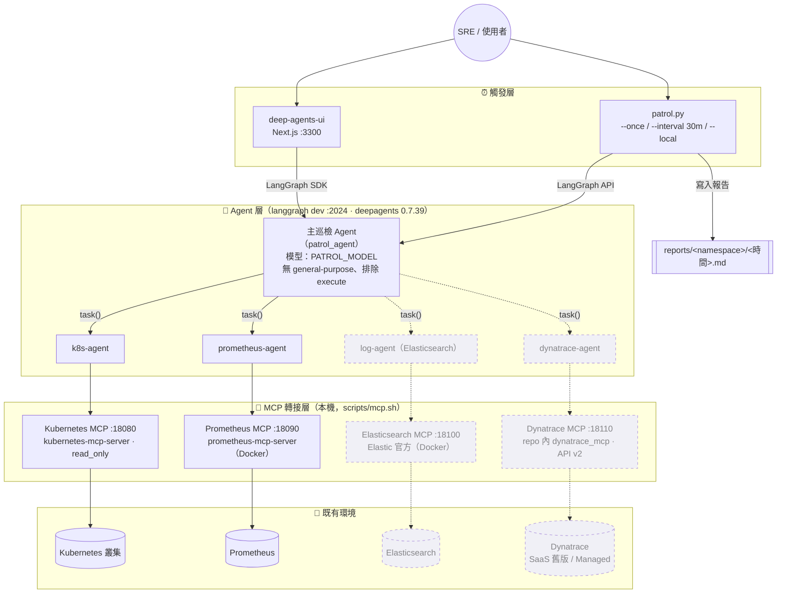
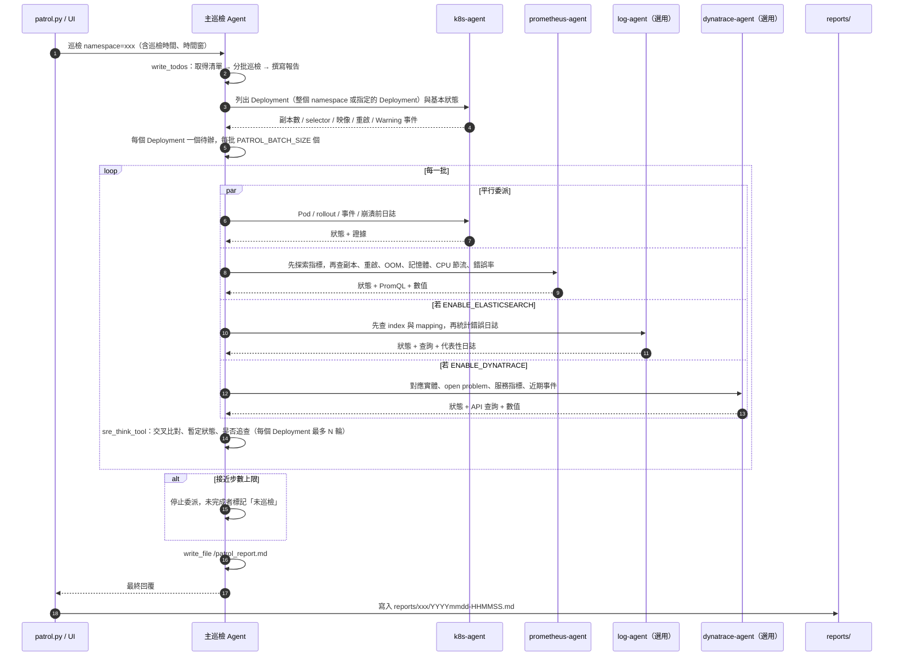

# SRE Patrol Agent

[English](README_EN.md)

給定一個 Kubernetes namespace，自動巡檢底下所有 Deployment，產出巡檢報告的 AI Agent。

## 專案說明

### 要解決的問題
日常巡檢通常要在好幾個工具之間切換：先用 kubectl 看 Pod 有沒有重啟，再到 Prometheus 看資源和錯誤率，接著翻日誌、查 APM 的告警。服務一多，人工巡檢既耗時又容易漏看。

SRE Patrol Agent 把這件事交給 AI Agent：你只要給一個 namespace，它會自己列出所有 Deployment，到各個可觀測性工具收集證據，判斷每個 Deployment 是否健康，最後寫成一份報告。

### 運作方式
- **多 Agent 分工**：以 [deepagents](https://github.com/langchain-ai/deepagents) 0.7.39 建立一個主協調 Agent，搭配各資料來源的專門子 Agent。主 Agent 負責規劃、分批派工、綜合判斷；子 Agent 負責在各自的領域查資料。
- **透過 MCP 串接既有工具**：不需要改動現有的監控系統。**Kubernetes、Prometheus** 固定啟用；**Elasticsearch、Dynatrace** 為選用，預設關閉。
- **模型自主巡檢**：不需要事先寫巡檢清單。模型會先探索有哪些指標、日誌欄位和實體，再決定要查什麼，並與過去同時段比較來判斷是否異常。
- **以證據為準**：每個 Deployment 給出 OK / WARN / CRIT / UNKNOWN，每個結論都要附上查詢語句和數值，沒有證據的發現不會寫進報告。
- **觸發方式**：可以巡檢整個 namespace，或只巡檢指定的 Deployment；可以單次執行、定時排程，或在聊天介面手動下令；報告寫成 Markdown 檔。

### 設計原則
- **全程唯讀**：MCP server 以唯讀模式啟動、Agent 端有工具白名單、prompt 明確禁止修改，三層把關，不會動到叢集或任何資料。
- **成本與範圍可控**：限制每批平行數量、每個 Deployment 的委派輪數和整體步數；工具結果過長會截斷，並提示模型縮小查詢範圍。
- **資料來源可插拔**：選用來源用環境變數開關，關閉時對應的子 Agent、工具、prompt 段落和 MCP server 都不會載入。
- **報告只做判斷與建議**：Agent 不會自動修復，報告中的推論應由人員確認後再採取行動。

## 架構圖

虛線為選用元件，預設關閉，用 `ENABLE_ELASTICSEARCH` / `ENABLE_DYNATRACE` 開啟。



## Agent 運作流程



**流程重點**
1. **先取得清單**：k8s-agent 列出 namespace 下所有 Deployment（或只取得指定的 Deployment）和基本狀態，主 Agent 為每個 Deployment 建立待辦。
2. **分批平行巡檢**：每批最多 `PATROL_BATCH_SIZE` 個 Deployment，同一批內同時委派給所有已啟用的子 Agent。
3. **綜合判斷**：每批結束後交叉比對各來源的證據，必要時追加委派，每個 Deployment 最多 `PATROL_MAX_ROUNDS_PER_DEPLOYMENT` 輪。
4. **產出報告**：取各來源中最嚴重的狀態作為結論，寫出總表、異常詳情和證據清單。接近步數上限時，會停止委派並把未完成的 Deployment 標記為「未巡檢」。

開關影響範圍與安全設計的細節見 [docs/architecture.md](docs/architecture.md)。

## 元件

| 層 | 元件 | 說明 |
| --- | --- | --- |
| 觸發 | `patrol_agent/patrol.py` | 單次或定時巡檢整個 namespace 或指定的 Deployment，報告寫到 `reports/` |
| 觸發 | `deep-agents-ui/` | 聊天介面，可追問或手動巡檢（:3300） |
| Agent | 主巡檢 Agent | 列出 Deployment → 分批委派 → 綜合判斷 → 寫報告 |
| Agent | `k8s-agent` | Deployment / Pod 狀態、重啟、OOM、Warning 事件、崩潰前日誌 |
| Agent | `prometheus-agent` | 資源用量、CPU 節流、記憶體佔 limit、錯誤率與延遲（與基準比較） |
| Agent | `log-agent`（選用） | Elasticsearch 錯誤日誌統計（先確認 index 與欄位） |
| Agent | `dynatrace-agent`（選用） | open problem、服務指標、近期部署與變更事件 |
| MCP | [kubernetes-mcp-server](https://github.com/containers/kubernetes-mcp-server) | 唯讀模式，npx 執行 |
| MCP | [prometheus-mcp-server](https://github.com/pab1it0/prometheus-mcp-server) | Docker 執行 |
| MCP | [Elastic mcp-server-elasticsearch](https://github.com/elastic/mcp-server-elasticsearch) | Docker 執行（選用） |
| MCP | `patrol_agent/dynatrace_mcp/` | 本 repo 內建，Dynatrace API v2 唯讀（選用） |

## 需求

- Python 3.11+ 與 [uv](https://docs.astral.sh/uv/)
- Node.js 20+（kubernetes-mcp-server 與 UI）
- Docker（Prometheus / Elasticsearch MCP）
- 一份**唯讀**的 kubeconfig（建議只授予 get / list / watch 權限）
- LLM API key（OpenAI、Anthropic 或 OpenAI 相容端點）

## 快速開始

### 1. 設定

```bash
cp patrol_agent/.env.example patrol_agent/.env
```

至少填寫：

- `PATROL_MODEL`（例如 `openai:gpt-5.2`、`anthropic:claude-sonnet-5-5`）與對應的 API key
- 使用 OpenAI 相容端點時填 `OPENAI_BASE_URL`
- `PROMETHEUS_URL`（MCP 跑在 Docker 裡，Prometheus 在本機時用 `http://host.docker.internal:9090`）
- `K8S_MCP_KUBECONFIG`（留空則用 `$KUBECONFIG` 或 `~/.kube/config`）

要啟用 Elasticsearch / Dynatrace 時，把 `ENABLE_ELASTICSEARCH` / `ENABLE_DYNATRACE` 設為 `true`，並填寫對應的連線設定。

### 2. 安裝相依套件

```bash
cd patrol_agent && uv sync
```

### 3. 啟動 MCP server

```bash
scripts/mcp.sh start
```

```bash
scripts/mcp.sh status
```

### 4. 啟動 Agent

```bash
cd patrol_agent && uv run langgraph dev --no-browser
```

### 5. 執行巡檢

單次巡檢：

```bash
cd patrol_agent && uv run python patrol.py --namespace payments --once
```

每 30 分鐘巡檢一次（可重複 `--namespace` 巡檢多個）：

```bash
cd patrol_agent && uv run python patrol.py --namespace payments --namespace orders --interval 30m
```

只巡檢指定的 Deployment（可重複 `--deployment` 指定多個；此時只能指定一個 namespace）：

```bash
cd patrol_agent && uv run python patrol.py --namespace payments --deployment checkout --once
```

不啟動 `langgraph dev`，直接在本機程序內執行：

```bash
cd patrol_agent && uv run python patrol.py --namespace payments --once --local
```

`--deployment`、`--interval`、`--local` 可以互相搭配，例如每 10 分鐘只巡檢 checkout：`--namespace payments --deployment checkout --interval 10m`。

報告會寫到 `reports/<namespace>/<YYYYmmdd-HHMMSS>.md`；指定 Deployment 時為 `reports/<namespace>/<YYYYmmdd-HHMMSS>-<deployment>.md`。
在聊天介面也可以直接要求，例如「只巡檢 payments 的 checkout」。

### 6.（選用）聊天介面

```bash
cd deep-agents-ui && yarn install && yarn dev
```

打開 http://localhost:3300，Deployment URL 填 `http://localhost:2024`，Assistant ID 填 `patrol_agent`。
透過 `patrol.py`（非 `--local`）執行的巡檢也會出現在 UI 的 thread 列表。

## 主要設定

| 環境變數 | 預設 | 說明 |
| --- | --- | --- |
| `PATROL_MODEL` | `openai:gpt-5.2` | 模型，`provider:model` 格式 |
| `ENABLE_ELASTICSEARCH` | `false` | 啟用 log-agent 與 Elasticsearch MCP |
| `ENABLE_DYNATRACE` | `false` | 啟用 dynatrace-agent 與 Dynatrace MCP |
| `PATROL_BATCH_SIZE` | `3` | 每批平行巡檢的 Deployment 數 |
| `PATROL_MAX_ROUNDS_PER_DEPLOYMENT` | `2` | 每個 Deployment 最多委派幾輪 |
| `PATROL_RECURSION_LIMIT` | `300` | 整次巡檢的步數上限 |
| `PATROL_LOOKBACK` | `1h` | 預設查詢時間窗 |
| `MCP_MAX_RESULT_CHARS` | `20000` | 單次工具結果上限，超過會截斷 |

完整清單見 [patrol_agent/.env.example](patrol_agent/.env.example)。開關與設定在 Agent 啟動時讀取，修改後要重啟 `langgraph dev`。

## 報告範例結構

```
# Kubernetes 巡檢報告：payments
- 巡檢時間 / 時間窗 / 資料來源啟用狀態 / 結果摘要
## 總表          每個 Deployment 一行：狀態、各來源狀態、一句話摘要
## 異常詳情      CRIT / WARN 的問題、證據、可能原因、建議
## 證據清單      [1] 來源 | 對象 | 查詢 | 數值 | 時間
```

## 開發

```bash
cd patrol_agent && uv run pytest
```

測試涵蓋：開關對子 Agent 與 prompt 的影響、移除 general-purpose、工具白名單、Dynatrace API 客戶端、報告擷取。

## 注意事項

- **Elastic 官方 MCP 已標示 deprecated**（只提供安全性更新），官方建議 Elastic 9.2+ 改用 Agent Builder MCP 端點。它支援 Elasticsearch 8.x / 9.x。工具名稱可用 `ES_MCP_TOOL_*` 環境變數覆寫，方便日後改接。
- **Dynatrace MCP 是本 repo 自寫**，針對 SaaS 舊版與 Managed 的 Environment API v2。Dynatrace 新平台（`*.apps.dynatrace.com`）可改用官方 [dynatrace-mcp](https://github.com/dynatrace-oss/dynatrace-mcp)。
- **不使用 LangSmith**：程式啟動時會強制關閉 LangSmith 追蹤並移除相關 API key 環境變數，巡檢資料不會送往 LangSmith。資料只會送到你設定的 LLM 服務。
- 模型判斷有不確定性；報告中的推論應由人員確認後再採取行動。

## 授權

MIT。本專案衍生自 [SRE-Agent](https://github.com/vapering/SRE-Agent)，原始著作權聲明保留於 [LICENSE](LICENSE)；`deep-agents-ui/` 來自 LangChain 的 deep-agents-ui（MIT，見 [deep-agents-ui/LICENSE](deep-agents-ui/LICENSE)）。
