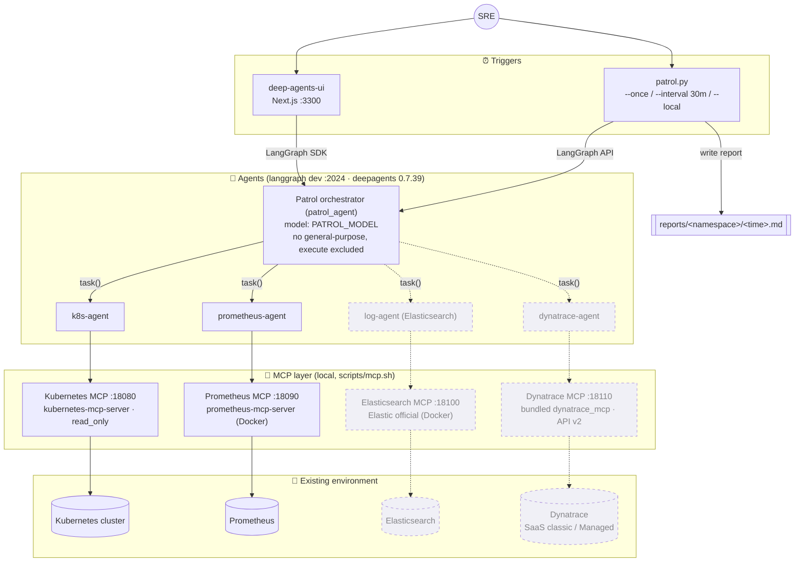
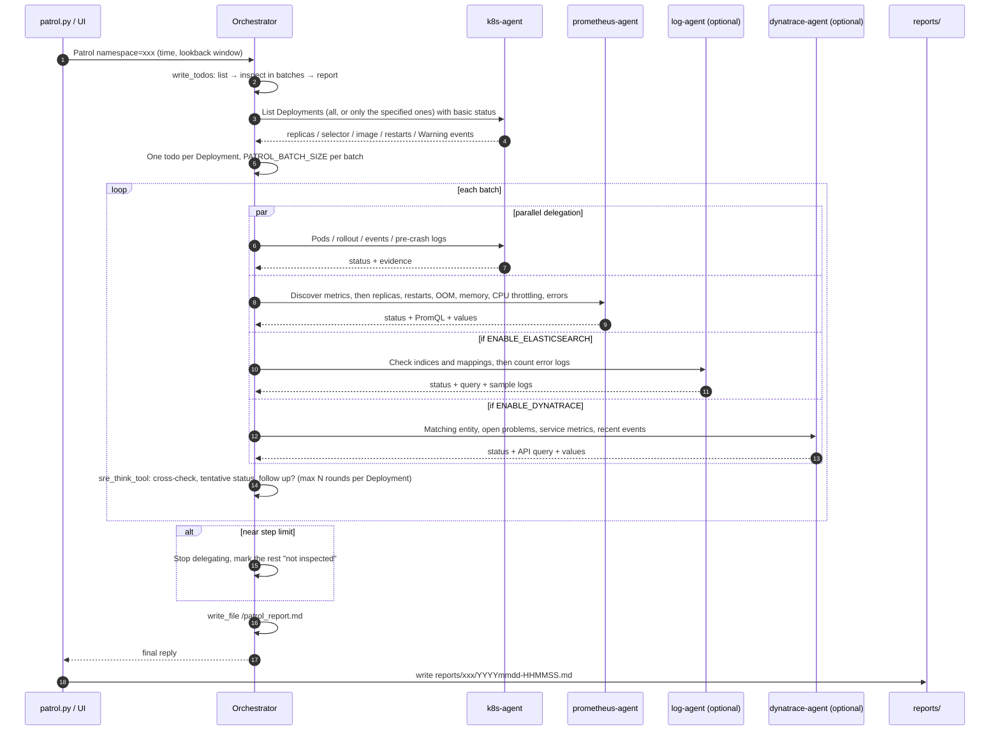

# SRE Patrol Agent

[繁體中文](README.md)

An AI agent that, given a Kubernetes namespace, automatically inspects every Deployment in it and writes an inspection report.

## Overview

### The problem
Routine health checks mean hopping between tools: kubectl for pod restarts, Prometheus for resources and error rates, then logs and APM alerts. With many services, manual inspection is slow and easy to get wrong.

SRE Patrol Agent hands this to an AI agent. Give it a namespace; it lists every Deployment, gathers evidence from each observability tool, judges each Deployment's health, and writes a report.

### How it works
- **Multi-agent**: built on [deepagents](https://github.com/langchain-ai/deepagents) 0.7.39. An orchestrator plans, delegates in batches and synthesizes; specialist sub-agents query their own data source.
- **MCP integration with existing tools**: no changes to your monitoring stack. **Kubernetes and Prometheus** are always on; **Elasticsearch and Dynatrace** are optional and off by default.
- **Model-driven inspection**: no predefined checklist. The model first discovers available metrics, log fields and entities, then decides what to check and compares against the same period in the past.
- **Evidence first**: each Deployment gets OK / WARN / CRIT / UNKNOWN, and every finding must cite the query and values. Findings without evidence are dropped.
- **Triggers**: run once, on a schedule, or from the chat UI. Reports are Markdown files.
- Prompts and reports are in Traditional Chinese.

### Design principles
- **Read-only, three layers**: MCP servers run read-only, the agent-side MCP client enforces a tool allowlist, and prompts forbid any change.
- **Bounded cost and scope**: limits on batch size, delegation rounds per Deployment, and total steps; oversized tool results are truncated with a hint to narrow the query.
- **Pluggable data sources**: optional sources are toggled by environment variables; when off, their sub-agent, tools, prompt sections and MCP server are not loaded.
- **Advice, not action**: the agent never remediates; a human should confirm its inferences before acting.

## Architecture

Dashed components are optional and off by default (`ENABLE_ELASTICSEARCH` / `ENABLE_DYNATRACE`).



## Agent flow



More detail on toggles and safety: [docs/architecture.md](docs/architecture.md).

## Quick start

```bash
cp patrol_agent/.env.example patrol_agent/.env
```

Fill in at least `PATROL_MODEL` (`provider:model`, e.g. `openai:gpt-5.2`), the matching API key, `PROMETHEUS_URL`, and optionally `K8S_MCP_KUBECONFIG` (a read-only kubeconfig is recommended).

```bash
cd patrol_agent && uv sync
```

```bash
scripts/mcp.sh start
```

```bash
cd patrol_agent && uv run langgraph dev --no-browser
```

```bash
cd patrol_agent && uv run python patrol.py --namespace payments --once
```

To inspect only specific Deployments (repeat `--deployment` for more; only one namespace is allowed then):

```bash
cd patrol_agent && uv run python patrol.py --namespace payments --deployment checkout --once
```

Use `--interval 30m` to run on a schedule, or `--local` to run the graph in-process without `langgraph dev`; these combine with `--deployment`. Reports go to `reports/<namespace>/<YYYYmmdd-HHMMSS>.md`, or `reports/<namespace>/<YYYYmmdd-HHMMSS>-<deployment>.md` when Deployments are specified.

Optional chat UI: `cd deep-agents-ui && yarn install && yarn dev`, then open http://localhost:3300 with Deployment URL `http://localhost:2024` and Assistant ID `patrol_agent`.

## Optional data sources

Set `ENABLE_ELASTICSEARCH=true` / `ENABLE_DYNATRACE=true` to enable them. When disabled (the default), the sub-agent is not registered, its tools are not loaded, the orchestrator prompt does not mention it, `scripts/mcp.sh` does not start its MCP server, and the report marks it as disabled. Restart `langgraph dev` after changing these flags.

- Elasticsearch uses Elastic's official MCP server, which is **deprecated** (security fixes only; Elastic recommends the Agent Builder MCP endpoint on 9.2+). It supports Elasticsearch 8.x / 9.x.
- LangSmith is not used: tracing is forced off at startup and LangSmith API key variables are removed, so inspection data is sent only to your configured LLM provider.
- Dynatrace uses a read-only MCP server bundled in this repo (`patrol_agent/dynatrace_mcp/`) for Dynatrace SaaS (classic) / Managed via Environment API v2.

## Tests

```bash
cd patrol_agent && uv run pytest
```

## License

MIT. Derived from [SRE-Agent](https://github.com/vapering/SRE-Agent); the original copyright notice is kept in [LICENSE](LICENSE). `deep-agents-ui/` comes from LangChain's deep-agents-ui (MIT, see [deep-agents-ui/LICENSE](deep-agents-ui/LICENSE)).
