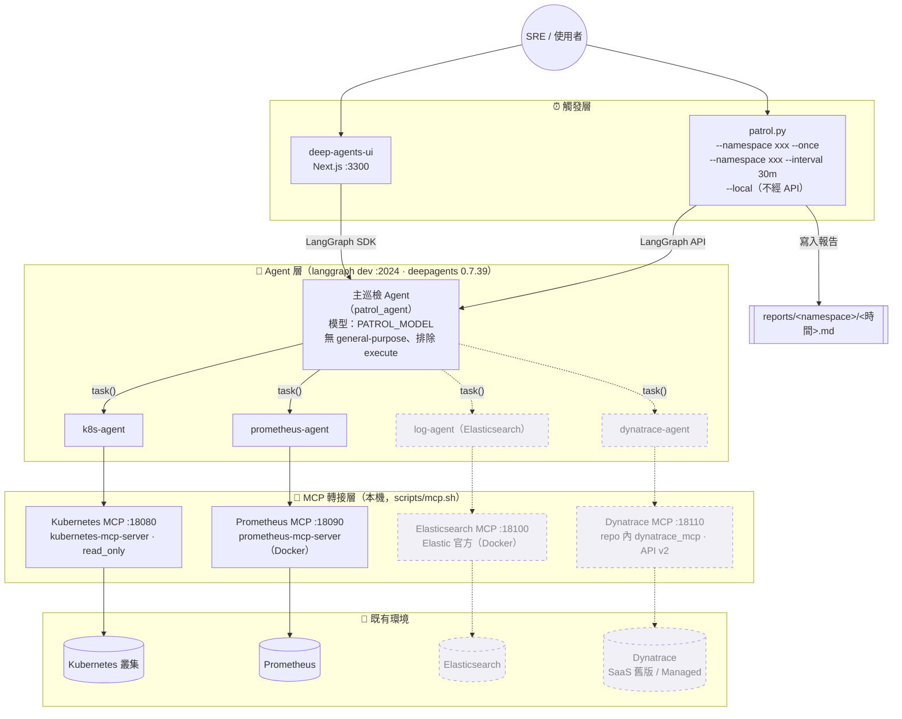
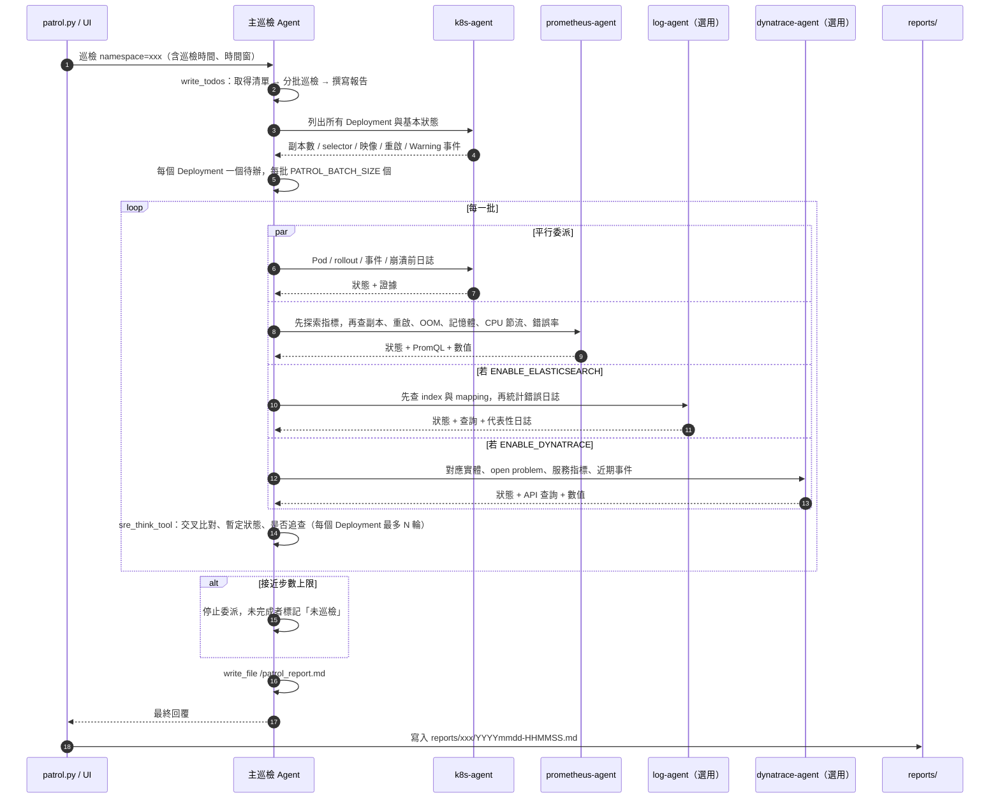

# 架構與運作流程

## 架構圖

虛線為選用元件，預設關閉，用 `ENABLE_ELASTICSEARCH` / `ENABLE_DYNATRACE` 開啟。

## 一次巡檢的運作流程

## 開關的影響範圍

| 範圍 | `ENABLE_ELASTICSEARCH=false` / `ENABLE_DYNATRACE=false`（預設） |
| --- | --- |
| 子 Agent | 不註冊 log-agent / dynatrace-agent |
| 工具 | 不 import 對應模組，不連線 MCP |
| 主 Agent prompt | 可用子 Agent、派工步驟、判斷標準、報告欄位都不包含該來源 |
| `scripts/mcp.sh` | 不啟動對應 MCP server |
| 報告 | 開頭標註「未啟用」 |

開關在 Agent 啟動時讀取，修改後要重啟 `langgraph dev`。

## 安全設計

- **三層唯讀**：
  1. MCP server 本身以唯讀模式啟動（kubernetes-mcp-server `read_only = true`；Dynatrace MCP 只有 GET）。
  2. Agent 端的 MCP 客戶端有工具白名單（`mcp_client.MCPClient.allowed_tools`），白名單外的工具一律拒絕。
  3. prompt 明確禁止任何修改動作。
- **移除不需要的能力**：透過 deepagents harness profile 移除 general-purpose 子 Agent，並排除 `execute` 工具。
- **步數上限**：`PATROL_RECURSION_LIMIT`；每批數量 `PATROL_BATCH_SIZE`；每個 Deployment 委派輪數 `PATROL_MAX_ROUNDS_PER_DEPLOYMENT`。
- **結果截斷**：單次工具結果超過 `MCP_MAX_RESULT_CHARS` 會截斷並提示模型縮小查詢範圍。
